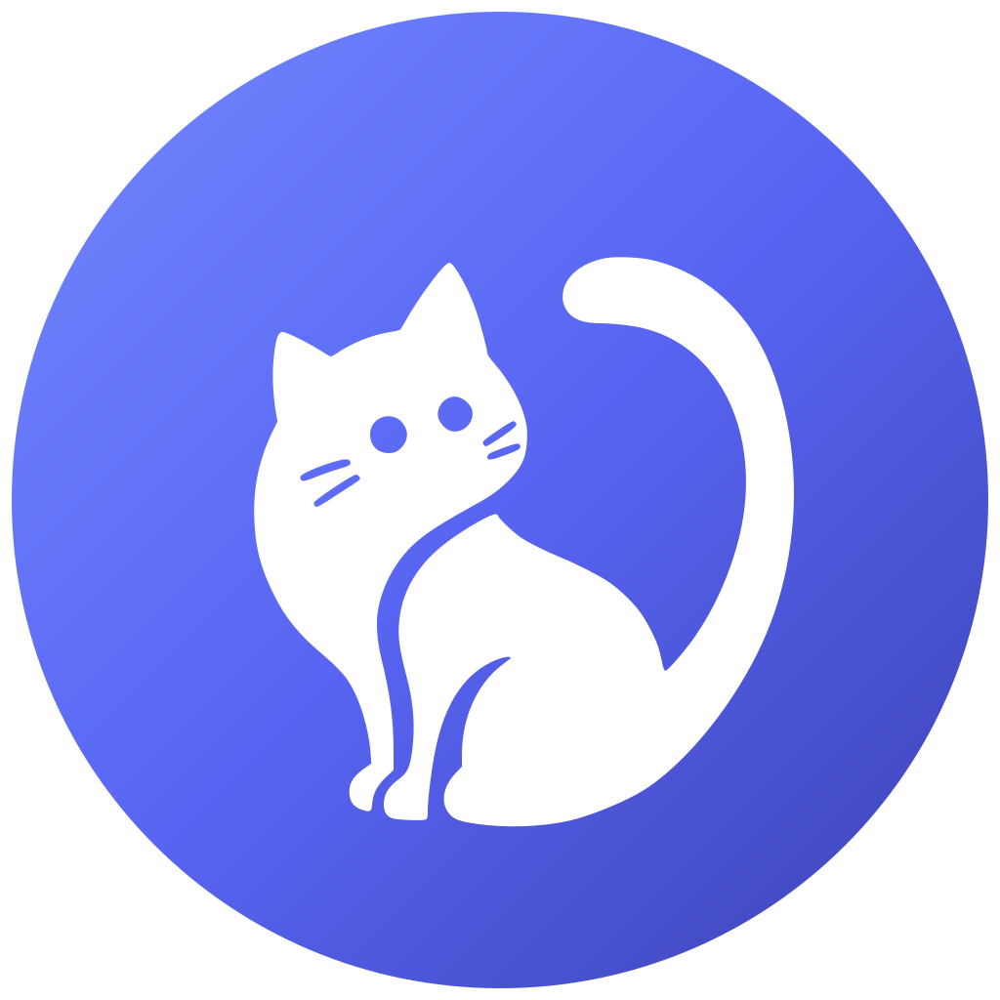

<div align="center">



# Dohcord

**A fast, lightweight Discord client with Vencord built in, native DNS over HTTPS and optional connection profiles.**

Encrypt your DNS lookups, defeat DNS-level censorship, and stay connected on restricted networks.

**Dohcord 1.7.1** adds optional [Connection Profiles](#connection-profiles): route approved Discord
traffic through the built-in Newipe relay or your own compatible relay server, completely
independently of DNS over HTTPS.

[](#installation)
[](LICENSE)
[](../../releases/latest)
[](../../actions/workflows/test.yml)

</div>

---

## Table of Contents

- [Why Dohcord](#why-dohcord)
- [Features](#features)
- [How DoH Works](#how-doh-works)
- [Restricted Networks](#restricted-networks)
- [Connection Profiles](#connection-profiles)
- [Installation](#installation)
- [Enabling DoH](#enabling-doh)
- [Recommended Resolvers](#recommended-resolvers)
- [Settings Reference](#settings-reference)
- [FAQ](#faq)
- [Troubleshooting](#troubleshooting)
- [Building from Source](#building-from-source)
- [Project Layout](#project-layout)
- [Credits](#credits)
- [License](#license)

---

## Why Dohcord

Dohcord is a desktop client for Discord, built on [Vesktop](https://github.com/Vencord/Vesktop) and
shipped with [Vencord](https://vencord.dev) preinstalled. It is smaller, faster and more configurable
than the official client, and it runs natively on Windows, macOS and Linux.

The difference this fork makes is in the network stack. Ordinary DNS lookups travel in plain text, so
your ISP — or anything else on the network — can read them, spoof their answers, or block them
outright. Dohcord can route every lookup through [DNS over HTTPS](https://en.wikipedia.org/wiki/DNS_over_HTTPS)
instead, which wraps DNS inside a normal HTTPS connection to a resolver you choose. Lookups can no
longer be read or tampered with in transit, and DNS-based blocking stops working.

> [!NOTE]
> Dohcord is a fork of [Vesktop](https://github.com/Vencord/Vesktop). Credit for the base client goes
> to Vendicated and the Vencord contributors. This fork adds the DoH integration, the secure DNS
> settings and the custom SNI-proxy resolver support.

---

## Features

|     | Feature                 | Description                                                                             |
| --- | ----------------------- | --------------------------------------------------------------------------------------- |
| 🛡️  | **DNS over HTTPS**      | Encrypted lookups through any RFC 8484 resolver, with optional strict enforcement       |
| 🌍  | **Custom DoH routing**  | Built-in provider list, plus your own URL — including SNI-proxy resolvers               |
| 🔁  | **Fallback control**    | Choose between "encrypted or nothing" and falling back to plain DNS when needed         |
| 🩺  | **Resolver test**       | Resolve a hostname from the settings panel to confirm the active resolver works         |
| 🔀  | **Connection profiles** | Optional Newipe or self-hosted relay for Discord HTTPS/WSS and voice, separate from DoH |
| 🧩  | **Vencord built in**    | The full plugin, theme and tweak ecosystem, ready out of the box                        |
| 🐧  | **Linux first-class**   | Native Wayland, screen sharing with audio, and better performance                       |
| ⚡  | **Lightweight**         | No bundled Discord bloat, no telemetry — a noticeably snappier experience               |

---

## How DoH Works

**With the system resolver — every lookup is exposed:**

```text
   Dohcord
      │   plaintext DNS query
      ▼
System / ISP resolver
      │   blocked or spoofed answer
      ▼
Connection fails ✗
```

**With DoH — lookups are encrypted end to end:**

```text
   Dohcord
      │   DNS query inside HTTPS
      ▼
DoH resolver  (Cloudflare, Google, or your own)
      │   real Discord address
      ▼
Connected ✓
```

|                             | System resolver | DNS over HTTPS |
| --------------------------- | :-------------: | :------------: |
| Lookup visibility           |    Plaintext    |   Encrypted    |
| Spoofing / hijacking        |     Trivial     |   Prevented    |
| DNS-level blocking          |    Effective    |    Bypassed    |
| Affects the rest of your OS |        —        |       No       |

### Implementation

Dohcord hands the resolver configuration to Chromium's own host resolver, so the setting applies to
every connection the app makes and nothing else on your computer:

```ts
app.configureHostResolver({
    secureDnsMode: "secure", // never fall back to plain DNS
    secureDnsServers: ["https://cloudflare-dns.com/dns-query"] // the RFC 8484 endpoint
});
```

- A URL is validated before it is applied. An unusable resolver never takes over your networking,
  and the previous configuration stays active while you edit it.
- `secureDnsMode` is `"secure"` by default. Enabling **Allow Insecure Fallback** switches it to
  `"automatic"`, which permits plain DNS when the DoH server cannot be reached.
- The configuration is only re-applied when it actually changes, so editing a setting does not
  flush Chromium's host cache repeatedly.

---

## Restricted Networks

On heavily filtered networks, Discord is often blocked at the DNS or SNI layer. Dohcord works with
DoH resolvers that answer with a **Smart DNS / SNI proxy** address, which lets you keep using Discord
without installing a VPN.

1. Dohcord asks the resolver for Discord's address over encrypted HTTPS.
2. The resolver answers with the address of an **SNI proxy** instead of Discord's real server.
3. Dohcord connects to that proxy, which reads the TLS SNI header and forwards the connection to
   Discord — past the local network filters.

**Example resolver:**

```text
https://newipe.qd.je/dns-query
```

> [!WARNING]
> That resolver is tuned for Iranian networks and routes traffic through an SNI proxy. It may not
> work, or may be slower, elsewhere.

---

## Connection Profiles

A **connection profile** is an optional networking mode for Discord itself. When one is selected,
Dohcord routes only the Discord destinations the profile allows through an HTTPS CONNECT proxy
and, when the profile provides one, relays Discord voice media through TURN. Other apps and the
rest of your computer are never affected.

| Choice         | What it does                                                                                                           |
| -------------- | ---------------------------------------------------------------------------------------------------------------------- |
| **No Profile** | Direct connection. Discord uses the same networking as a normal Discord client.                                        |
| **Newipe**     | Built-in profile that uses Newipe's relay infrastructure. No configuration required.                                   |
| **Custom**     | Your own compatible Dohcord-relay server. Only the profile name and the server's Network Configuration URL are needed. |

A profile is **not** a VPN. Only approved Discord HTTPS and WebSocket destinations use the proxy;
everything else keeps using your normal connection. The relay forwards Discord's already-encrypted
TLS traffic and never decrypts the inner Discord connection. TURN is a separate media relay for
voice traffic.

### Profiles vs DNS over HTTPS

| Setting            | Purpose                                                        |
| ------------------ | -------------------------------------------------------------- |
| **Profiles**       | Selective Discord HTTPS/WSS proxy routing and RTC relay        |
| **DNS over HTTPS** | Chooses the DNS resolver used to turn hostnames into addresses |

They are completely independent settings:

- Selecting the **Newipe** profile never selects Newipe DoH.
- Selecting **Cloudflare** DoH never changes the selected profile.
- Newipe Profile with Cloudflare DoH is a valid combination, and so is Direct Connection with
  Newipe DoH.
- Disabling DoH, or changing the resolver, never disables or changes the proxy.
- Changing or removing a custom profile never changes your DNS provider.

### Using the Newipe profile

1. Open Dohcord and either complete the first-launch setup or open **User Settings** → **Dohcord**.
2. Find **Connection Profile**.
3. Select **Newipe**.
4. Dohcord retrieves and validates the profile's Network Configuration automatically.
5. Once the status shows **Connected**, use Discord normally.

Newipe uses this Network Configuration endpoint:

```text
https://13.48.52.216:8443/network-config
```

You do not need to enter proxy addresses, ports, TURN servers, credentials, destination domains or
allowed ports. They all come from that endpoint.

> [!NOTE]
> Port **8443** is the Network Configuration endpoint. The HTTPS proxy is a separate connection and
> normally runs on TCP **443**, as configured by the relay. TURN uses the server-provided settings.

### Custom profiles

Custom profiles let you use your own relay server. **Dohcord-relay is a separate server-side
project**; Dohcord is only the client and does not run a relay for you.

1. Install and configure a compatible Dohcord-relay server.
2. Copy the **Network Configuration URL** it generates.
3. In Dohcord, open **User Settings** → **Dohcord** → **Connection Profile**.
4. Click **Manage Profiles** → **Add Custom Profile**.
5. Enter a **Profile Name** and paste the **Network Configuration URL**.
6. Click **Save Profile**, then select the new profile.

Only those two values are required. Dohcord contacts the endpoint, validates the returned
configuration, and only then accepts the profile. If the endpoint is unreachable or returns an
invalid or expired configuration, you get an error and can retry or pick another profile.

### Managing profiles

- **Add**, **edit** and **remove** your own custom profiles under **Manage Profiles**.
- The built-in **Newipe** profile cannot be edited or removed.
- Your selection is remembered after Dohcord restarts.
- Select **No Profile — Direct Connection** to return to normal direct networking.
- Custom profile names and URLs live in `custom-profiles.json` in the
  [data directory](#manually-when-discord-will-not-load). They are kept separate from the
  built-in profiles shipped with the app.

### Connection behaviour

- The Network Configuration endpoint must be reachable when a profile is activated and whenever its
  temporary credentials need refreshing.
- Only approved Discord domains and ports are routed through the proxy. A hostname such as
  `discord.com.evil.example` never matches `discord.com`, and unrelated traffic stays direct.
- If the proxy cannot be reached, approved Discord destinations are **not** silently sent direct.
  Discord reports a connection error and the profile status shows **Unavailable**, with **Retry**
  available in settings. Choose **No Profile** to go back to direct networking.
- If TURN fails, Discord voice can fall back to direct ICE without changing the HTTPS proxy policy.
  The profile card reports the voice state honestly.
- Switching to **No Profile** removes the proxy configuration and restores direct Discord
  networking.

> [!WARNING]
> If a selected profile is unavailable when Dohcord starts, Discord cannot connect until the relay
> is reachable again or you select **No Profile**. You can switch back by editing `settings.json`
> (see [Manually, when Discord will not load](#manually-when-discord-will-not-load)) or by using
> **Reset Dohcord** in the app menu.

### Privacy and security

- The connection between Dohcord and the relay is protected by TLS. The relay forwards Discord's
  encrypted TLS connection without decrypting it; Dohcord never installs a custom CA or bypasses
  certificate validation.
- TURN provides separate relay functionality for Discord voice media.
- DoH is independent: it changes how hostnames are resolved, while a profile changes where approved
  Discord connections go.
- A profile is **not** a full-device VPN. The relay operator can observe connection metadata such as
  the destinations you connect to, and your own network can still see the relay's IP address,
  connection timing and traffic volume.
- The relay's IP address or ports can still be blocked by your network. A profile does not guarantee
  anonymity and is not advertised as a way to defeat every kind of deep packet inspection.

---

## Installation

Prebuilt binaries are published on the **[Releases](../../releases/latest)** page.

| Platform  | Packages                               |
| --------- | -------------------------------------- |
| ⊞ Windows | `.exe` (installer), `.zip`             |
| 🍎 macOS  | `.dmg`, `.zip`                         |
| 🐧 Linux  | `.AppImage`, `.deb`, `.rpm`, `.tar.gz` |

> [!TIP]
> **macOS builds are unsigned,** so Gatekeeper will warn you the first time you open the app.
> Right-click the app and choose **Open**, or allow it under _System Settings → Privacy & Security_.
> If macOS claims the app is damaged, run `xattr -cr /Applications/Dohcord.app`.

---

## Enabling DoH

### First launch

The setup window opens on first start. Optionally choose a relay under **Profiles → Connection
Profile**, then pick a provider under **DNS over HTTPS → Secure DNS Provider**, or choose **Custom**
and paste your own resolver URL. Press **Get Started** when you are done.

### Any time later

1. Open **User Settings** (the gear icon in the bottom-left corner).
2. Scroll the settings sidebar down to **Dohcord**.
3. Find **DNS over HTTPS** and select a provider, or **Custom** for your own URL.

The panel shows what is currently active:

| Status         | Meaning                                                                         |
| -------------- | ------------------------------------------------------------------------------- |
| **Encrypted**  | A valid resolver is configured and lookups are being encrypted                  |
| **Incomplete** | A custom URL is being edited; the resolver above stays active until it is valid |
| **Disabled**   | Lookups use the system resolver and can be read or blocked                      |

Custom URLs are validated and saved when you press **Enter** or click away. Click **Test Resolution**
to resolve `discord.com` through the currently applied resolver and see the addresses and timing.

> [!NOTE]
> New connections pick up the new resolver immediately. Connections that are already open keep the
> addresses they resolved earlier, so restart Dohcord if something still looks off.

### Manually, when Discord will not load

If Discord is blocked hard enough that the settings panel is out of reach, edit the config file
directly:

1. **Quit Dohcord completely.**
2. Open `settings.json`:

    | Platform | Path                                                  |
    | -------- | ----------------------------------------------------- |
    | Windows  | `%appdata%\Dohcord\settings.json`                     |
    | Linux    | `~/.config/Dohcord/settings.json`                     |
    | macOS    | `~/Library/Application Support/Dohcord/settings.json` |

3. Add or change these keys:

    ```json
    {
        "enableDoh": true,
        "dohUrl": "https://newipe.qd.je/dns-query",
        "dohAllowFallback": false
    }
    ```

4. Save the file and start Dohcord.

Setting `"dohAllowFallback": true` allows plain DNS when the resolver is unreachable, which is a
useful escape hatch if you are not sure about your resolver.

> [!NOTE]
> The provider list is fetched from [`resolvers.json`](resolvers.json) at startup, so providers can
> be added or updated without shipping a new release. If the file cannot be fetched, the built-in
> list is used instead.

---

## Recommended Resolvers

Any RFC 8484–compliant resolver works, with or without a `/dns-query` path.

### Global — privacy and anti-spoofing

| Provider       | URL                                    | Notes                               |
| -------------- | -------------------------------------- | ----------------------------------- |
| **Cloudflare** | `https://cloudflare-dns.com/dns-query` | Fast, privacy focused               |
| **Google**     | `https://dns.google/dns-query`         | Reliable global coverage            |
| **Quad9**      | `https://dns.quad9.net/dns-query`      | Blocks malware and phishing domains |
| **OpenDNS**    | `https://doh.opendns.com/dns-query`    | Optional content filtering          |

### Censorship bypass

| Provider       | URL                                  | Notes                                     |
| -------------- | ------------------------------------ | ----------------------------------------- |
| **Newipe**     | `https://newipe.qd.je/dns-query`     | Iran only — routes through an SNI proxy   |
| **VanillaApp** | `https://dns.vanillapp.ir/dns-query` | Iran — requires registering your IP first |

---

## Settings Reference

Dohcord stores its settings in `settings.json` inside the [data directory](#manually-when-discord-will-not-load).

| Key                | Type      | Default | Description                                                                  |
| ------------------ | --------- | ------- | ---------------------------------------------------------------------------- |
| `enableDoh`        | `boolean` | `false` | Whether lookups are sent to the configured DoH resolver                      |
| `dohUrl`           | `string`  | —       | The RFC 8484 endpoint to use, e.g. `https://cloudflare-dns.com/dns-query`    |
| `dohAllowFallback` | `boolean` | `false` | Allow plain DNS when the DoH resolver cannot be reached                      |
| `profileId`        | `string`  | —       | Selected connection profile id, e.g. `newipe`. Omitted for Direct Connection |

Built-in profiles are read from [`profiles.json`](profiles.json). Your custom profiles are stored
separately in `custom-profiles.json` in the same data directory. Temporary TURN credentials are kept
in memory only and are never written to either file.

---

## FAQ

**Does DoH encrypt my messages and calls?**
No. DoH only encrypts the DNS lookup that finds Discord's address. Your messages, voice and media
were already protected by Discord's own TLS connections.

**Does this guarantee access if Discord is blocked?**
It depends on how it is blocked. DNS poisoning and plain SNI filtering are usually defeated by DoH
plus an SNI-proxying resolver. If your network blocks the resolver or the proxy by IP, DoH alone
cannot help.

**What happens if my resolver goes down?**
With **Allow Insecure Fallback** disabled (the default) Dohcord refuses to use plain DNS, so nothing
resolves until the resolver is reachable again. Enable the fallback if you would rather stay online
with unencrypted lookups.

**Can I use my own resolver?**
Yes. Self-hosted resolvers are supported as long as they speak standard DoH
(`application/dns-message`) over HTTPS. Enter the full URL under **Custom**.

**Why not set DoH in my OS or on my router?**
Setting it in Dohcord scopes the change to this app: the rest of your computer keeps using its normal
DNS, and the setting still works when the OS or router refuses to let you change DNS.

**Does a profile route all my traffic through a VPN?**
No. A profile only routes approved Discord HTTPS and WebSocket destinations through the relay, plus
optional Discord voice media through TURN. Everything else keeps using your normal connection.

**Do Profiles and DoH interfere with each other?**
No. They are separate settings. You can use Newipe Profile with Cloudflare DoH, Direct Connection
with Newipe DoH, or any other combination. Changing one never changes the other.

**Can I share my custom profile with someone else?**
They only need the Network Configuration URL and a name. TURN credentials are temporary and are
issued by the server, so never copy them anywhere.

**Does this work on any network?**
Dohcord hides the DNS lookup and, with an SNI-proxying resolver, the address you connect to. It is
not a full VPN: traffic patterns and IP-level blocks remain visible to your network.

---

## Troubleshooting

| Problem                              | Fix                                                                                                                                                                         |
| ------------------------------------ | --------------------------------------------------------------------------------------------------------------------------------------------------------------------------- |
| Status shows **Incomplete**          | The custom URL is empty or not a valid `https://` endpoint. Finish it and press Enter, or pick a provider from the list.                                                    |
| Discord will not load after enabling | The resolver may be down or blocking you. Pick another provider, or enable **Allow Insecure Fallback** to keep working.                                                     |
| Stuck on "Connecting…"               | The resolver is returning an address your network blocks by IP. Try a resolver that routes through a proxy, such as Newipe.                                                 |
| **Test Resolution** fails            | The resolver is unreachable from your network. Try another provider or check your connection.                                                                               |
| Profile shows **Unavailable**        | The relay or its configuration endpoint cannot be reached. Click **Retry**, check the relay server, or choose **No Profile**.                                               |
| Profile shows **Invalid config**     | The endpoint returned a configuration outside Dohcord's Discord policy or with expired credentials. Fix the relay server or retry.                                          |
| Discord will not load with a profile | The selected profile was unavailable at startup and Discord traffic is held back instead of leaking direct. Retry, or select **No Profile** in settings or `settings.json`. |
| macOS says the app is damaged        | Gatekeeper, not corruption. Right-click → **Open**, or run `xattr -cr /Applications/Dohcord.app`.                                                                           |

---

## Building from Source

You need [Git](https://git-scm.com), [Node.js](https://nodejs.org) 22 or newer, and
[pnpm](https://pnpm.io) 11 or newer (`npm install --global pnpm`).

```sh
git clone https://github.com/Newipe/Dohcord
cd Dohcord

pnpm i                  # install dependencies

pnpm start              # build and run without packaging
pnpm start:watch        # rebuild and restart on file changes

pnpm test               # lint + typecheck
pnpm lint:fix           # auto-fix lint issues
```

Packaging uses [electron-builder](https://www.electron.build):

```sh
pnpm package                    # installers for the current platform
pnpm package:dir                # unpacked build only, no installers
pnpm electron-builder --linux deb   # a single target
```

| Platform | Targets                                |
| -------- | -------------------------------------- |
| Windows  | NSIS installer (`.exe`), `.zip`        |
| macOS    | `.dmg`, `.zip` (universal, unsigned)   |
| Linux    | `.AppImage`, `.deb`, `.rpm`, `.tar.gz` |

Releases are produced by [`.github/workflows/release.yml`](.github/workflows/release.yml) when a
tag matching `v*` is pushed.

> [!NOTE]
> On Linux, Vesktop uses a small C++ helper library (**LibVesktop**) to emit D-Bus events. Prebuilt
> binaries are used by default; build it yourself with `pnpm buildLibVesktop` if you have the
> required toolchain.
>
> Building LibVesktop requires native build dependencies. On Debian/Ubuntu, install
> `build-essential python3 curl pkg-config libglib2.0-dev`; on Fedora, install
> `@c-development @development-tools python3 curl pkgconf-pkg-config glib2-devel`.

---

## Project Layout

```text
src/
├── main/            Electron main process: windows, tray, updater, networking
│   ├── main.ts      Host resolver configuration (DoH) and app bootstrapping
│   ├── profiles.ts  Profile loading, config validation, PAC policy and proxy checks
│   ├── rtcRelay.ts  Publishes the active profile's TURN configuration to Discord
│   └── ipc.ts       IPC handlers, including the resolver test and profile management
├── preload/         Bridge exposed to the renderer as VesktopNative
│   ├── rtcRelay.ts  Wraps Discord's real RTCPeerConnection for the RTC relay
│   └── index.ts
├── renderer/        Vencord plugins and the Dohcord settings UI
│   └── components/settings/
│       ├── Profiles.tsx
│       └── DoH.tsx
└── shared/          Code shared between processes
    ├── doh.ts       Resolver list, URL validation and parsing
    ├── profiles.ts  Profile types, Network Configuration validation and PAC generation
    └── settings.d.ts

resolvers.json       DoH provider list fetched at runtime (DNS only)
profiles.json        Built-in connection profiles packaged with the app
static/views/        Splash, first-launch and updater windows
```

---

## Credits

- **[Vesktop](https://github.com/Vencord/Vesktop)** — the base client and its Linux work, by
  Vendicated and the Vesktop contributors
- **[Vencord](https://vencord.dev)** — the client mod that powers plugins, themes and tweaks
- **[Discord RPC](https://github.com/Vencord/Vesktop/tree/main/packages/discord-rpc)** — Rich Presence support
- **[venmic](https://github.com/Vencord/venmic)** — audio capture for Linux screen sharing
- **[Newipe](https://github.com/Newipe)** — this fork: DoH integration, secure DNS settings, the
  SNI-proxy resolver at `https://newipe.qd.je/dns-query` and the built-in Newipe connection profile

## License

GPL-3.0-or-later, inherited from upstream Vesktop. See [LICENSE](LICENSE) for details.

---

<div align="center">

Not affiliated with, endorsed by, or sponsored by Discord Inc.

</div>
