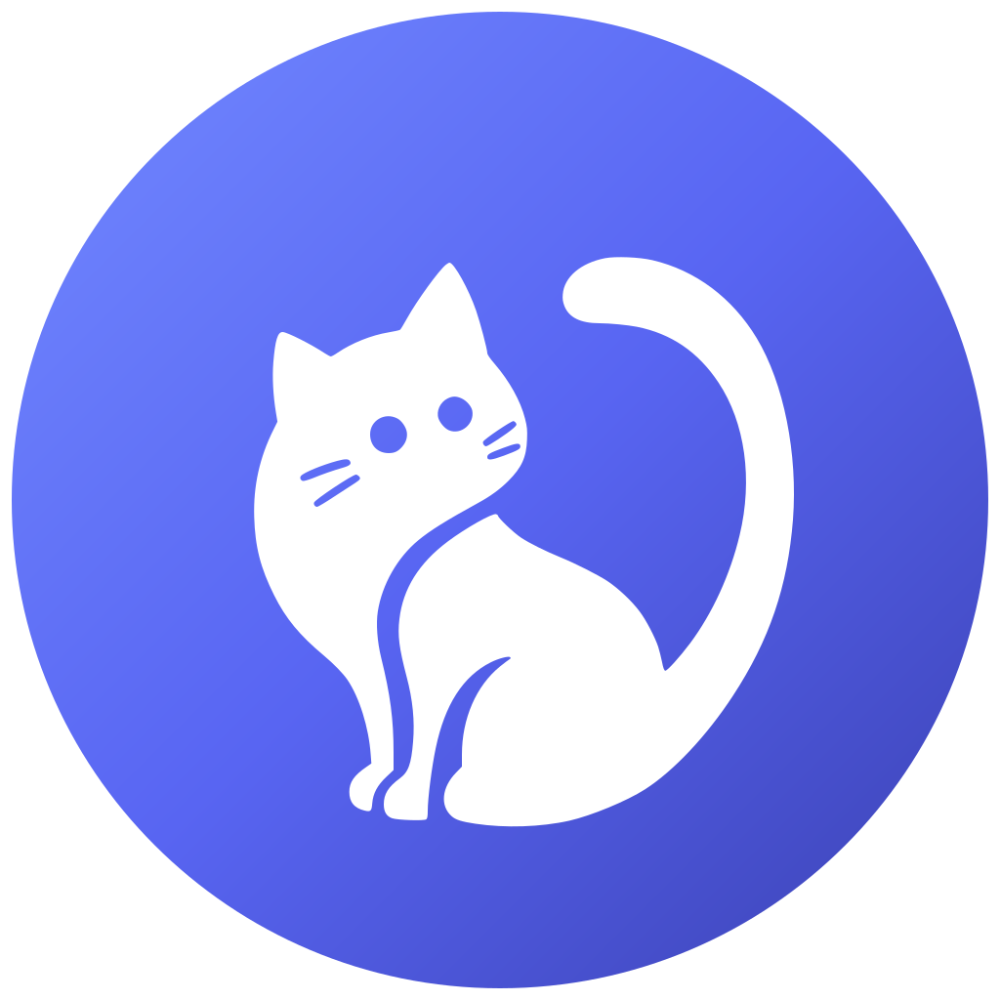

<div align="center">



# Dohcord

**A fast, lightweight Discord client with Vencord built in, native DNS over HTTPS and optional connection profiles.**

Connection Profiles are designed to help Discord connect on restricted networks, including some networks in Iran. They route only relay-approved Discord destinations through the Newipe relay or a compatible self-hosted relay. This can help with DNS- and SNI-based filtering, but access depends on the network and whether the relay is reachable.

**Dohcord 1.7.2** includes optional [Connection Profiles](#connection-profiles) for selective Discord routing. DNS over HTTPS (DoH) is a separate feature and is disabled while a profile is active.

[](#installation)
[](LICENSE)
[](../../releases/latest)
[](../../actions/workflows/test.yml)

</div>

---

<table>
  <tr>
    <td align="center">
      
    </td>
    <td align="center">
      
    </td>
  </tr>
</table>

## Contents

- [Overview](#overview)
- [DNS over HTTPS](#dns-over-https)
- [Connection Profiles](#connection-profiles)
- [Installation](#installation)
- [Recommended Resolvers](#recommended-resolvers)
- [Settings](#settings)
- [FAQ and Troubleshooting](#faq-and-troubleshooting)
- [Building from Source](#building-from-source)
- [Credits](#credits)
- [Support Dohcord](#support-dohcord)
- [License](#license)

---

## Overview

Dohcord is a desktop Discord client based on [Vesktop](https://github.com/Vencord/Vesktop), with [Vencord](https://vencord.dev) included. It runs on Windows, macOS and Linux, and adds app-level DNS over HTTPS plus optional connection profiles.

### Features

- **DNS over HTTPS:** encrypt DNS lookups using any RFC 8484-compatible resolver.
- **Custom resolvers:** choose a built-in provider or enter your own DoH URL, including SNI-proxy resolvers.
- **Fallback control:** choose whether Dohcord may use ordinary DNS when the DoH resolver is unavailable.
- **Resolver testing:** test a hostname from the settings panel.
- **Connection Profiles:** selectively route approved Discord HTTPS/WebSocket traffic through an HTTPS relay, with optional TURN for voice media. Designed to help on restricted networks, including some networks in Iran, without a VPN.
- **Vencord included:** plugins, themes and tweaks are ready to use.
- **Linux support:** native Wayland support and screen sharing with audio.

> [!NOTE]
> Dohcord is a fork of [Vesktop](https://github.com/Vencord/Vesktop). The base client and its upstream work are credited below; this fork adds DoH integration and connection profiles.

---

## DNS over HTTPS

Normally, DNS queries may travel in plaintext and can be observed, modified or blocked by the network's resolver. DoH sends those queries inside HTTPS to a resolver you choose. This protects the DNS lookup in transit; it does not encrypt Discord messages or replace Discord's own TLS security.

DoH is configured inside Chromium's host resolver, so it affects Dohcord only — not other applications or your operating system.

### Enable DoH

1. Open **User Settings** (the gear icon).
2. Open **Dohcord** in the settings sidebar.
3. Under **DNS over HTTPS**, select a provider or choose **Custom** and enter an HTTPS resolver URL.
4. Use **Test Resolution** to check that the resolver can resolve `discord.com`.

On first launch, choose **No Profile — Direct Connection** to configure DoH under **DNS over HTTPS → Secure DNS Provider**, then press **Get Started**. DoH cannot be enabled while a connection profile is selected.

### Resolver behaviour

- **Encrypted:** a valid DoH resolver is active.
- **Incomplete:** a custom URL is being edited; the previous valid resolver remains active.
- **Disabled:** Dohcord uses the system resolver.
- **Allow Insecure Fallback** is off by default. When enabled, Dohcord may fall back to ordinary DNS if the DoH resolver cannot be reached.

New connections use the updated resolver. Existing connections may retain previously resolved addresses; restart Dohcord if needed.

### Manual configuration

When the settings window cannot be reached, quit Dohcord and edit `settings.json` in the app's data directory:

| Platform | Path                                                  |
| -------- | ----------------------------------------------------- |
| Windows  | `%appdata%\Dohcord\settings.json`                     |
| Linux    | `~/.config/Dohcord/settings.json`                     |
| macOS    | `~/Library/Application Support/Dohcord/settings.json` |

Example:

```json
  "enableDoh": false,
  "dohAllowFallback": false,
  "profileId": "newipe",
```

A selected connection profile disables DoH regardless of these values. Set `"profileId"` to `null` (or select **No Profile — Direct Connection**) before enabling it.

The built-in resolver list is loaded from [`resolvers.json`](resolvers.json) at startup. If it cannot be fetched, Dohcord uses its packaged list.

---

## Connection Profiles

A connection profile changes how **Discord** connects. Dohcord routes only the Discord HTTPS and WebSocket destinations approved by the profile through an HTTPS CONNECT proxy. If the profile provides TURN settings, Discord can use that relay for voice media. Other applications and destinations not included in the profile policy continue using your normal network connection.

### Designed for restricted networks, including Iran

Some restricted networks, including networks in Iran, interfere with DNS responses or filter TLS connections using the Server Name Indication (SNI). The built-in **Newipe** profiles are designed to help with these kinds of restrictions. Dohcord first establishes a TLS-protected connection to the relay, then sends the approved Discord proxy requests through that connection. The local network can see the relay endpoint, but the CONNECT destination and Discord's inner TLS SNI are carried inside the encrypted connection.

This can help when filtering is based on DNS or the Discord hostname in SNI. It does not help if the relay's IP address or port is blocked, and availability and speed can vary by ISP and network. The relay operator can see your source IP, the destination host and port requested through the proxy, connection timing and traffic volume; the relay does not decrypt Discord's inner TLS traffic.

| Profile                            | Description                                                                                                |
| ---------------------------------- | ---------------------------------------------------------------------------------------------------------- |
| **No Profile — Direct Connection** | Normal direct Discord connection. DoH can be enabled.                                                      |
| **Newipe**                         | Built-in relay profile designed for restricted networks, including Iran. No manual configuration required. |
| **Newipe 2**                       | Backup relay profile for use when the primary Newipe relay is unreachable.                                 |
| **Custom**                         | A compatible self-hosted Dohcord-relay server. Requires a profile name and Network Configuration URL.      |

### Use a built-in profile

During first launch, select **Newipe** or **Newipe 2** under **Profiles → Connection Profile**, then press **Get Started**. Later, open **User Settings → Dohcord → Connection Profile** and choose a profile. Dohcord fetches and validates its network configuration automatically.

### Add a custom profile

1. Install and configure a compatible [Dohcord-relay](https://github.com/Newipe/Dohcord-relay) server.
2. Copy the **Network Configuration URL** provided by the server.
3. In Dohcord, open **User Settings → Dohcord → Connection Profile**.
4. Select **Manage Profiles → Add Custom Profile**.
5. Enter a profile name and the Network Configuration URL, then save and select it.

Only the name and URL are required. Dohcord validates the server's response before accepting the profile. Custom profiles can be edited or removed under **Manage Profiles**; built-in profiles cannot.

### Important profile behaviour

- **Profiles and DoH are mutually exclusive.** DoH is switched off and cannot be re-enabled while any profile is selected. Returning to Direct Connection makes DoH available again, but does not turn it back on automatically.
- The relay's Network Configuration endpoint supplies the proxy, routing policy, allowed ports and temporary TURN settings. The relay is authoritative; Dohcord does not contain a production domain allowlist.
- Built-in profile definitions are refreshed from the repository's [`profiles.json`](profiles.json) at startup. Restart Dohcord to pick up repository changes. If the download is unavailable or invalid, the packaged profiles remain in use.
- If the configuration endpoint cannot be reached or returns invalid data, Dohcord does not apply a partial or hardcoded fallback policy. If a previously validated policy is active, it remains in place while Dohcord retries.
- Approved destinations are not silently sent direct when the proxy is unavailable. Retry the profile or select **No Profile** to restore direct networking.
- If TURN is unavailable, Discord voice may fall back to direct ICE without changing the HTTPS proxy policy.

> [!WARNING]
> A connection profile is **not a VPN** and does not guarantee access on every network. Your network can still see the relay's IP address, connection timing and traffic volume. The relay operator can see the source IP and the destination host and port requested through the proxy, but the relay does not decrypt Discord's inner TLS traffic. IP-level blocks may still prevent access.

---

## Installation

Download a prebuilt version from the **[Releases](../../releases/latest)** page.

| Platform | Available packages                     |
| -------- | -------------------------------------- |
| Windows  | `.exe` installer, `.zip`               |
| macOS    | `.dmg`, `.zip`                         |
| Linux    | `.AppImage`, `.deb`, `.rpm`, `.tar.gz` |

> [!TIP]
> macOS builds are unsigned. If Gatekeeper blocks the app, right-click it and choose **Open**, or allow it under **System Settings → Privacy & Security**. If macOS reports that the app is damaged, run `xattr -cr /Applications/Dohcord.app`.

---

## Recommended Resolvers

Any RFC 8484-compatible resolver works.

| Provider       | URL                                    | Notes                           |
| -------------- | -------------------------------------- | ------------------------------- |
| **Cloudflare** | `https://cloudflare-dns.com/dns-query` | General-purpose resolver        |
| **Google**     | `https://dns.google/dns-query`         | Global coverage                 |
| **Quad9**      | `https://dns.quad9.net/dns-query`      | Malware and phishing protection |
| **OpenDNS**    | `https://doh.opendns.com/dns-query`    | Optional content filtering      |
| **Newipe**     | `https://newipe.qd.je/dns-query`       | Iran-focused SNI-proxy resolver |
| **VanillaApp** | `https://dns.vanillapp.ir/dns-query`   | Requires IP registration        |

Resolvers intended for restricted networks may not work, or may be slower, elsewhere.

---

## Settings

Dohcord stores settings in `settings.json` in the app's data directory.

| Key                | Type      | Default | Description                                                   |
| ------------------ | --------- | ------- | ------------------------------------------------------------- |
| `enableDoh`        | `boolean` | `false` | Enable DoH (ignored while a profile is selected).             |
| `dohUrl`           | `string`  | —       | DoH resolver URL.                                             |
| `dohAllowFallback` | `boolean` | `false` | Permit ordinary DNS if DoH is unavailable.                    |
| `profileId`        | `string`  | —       | Selected profile ID; omitted or `null` for Direct Connection. |

Built-in profiles are defined in [`profiles.json`](profiles.json); custom profiles are stored separately in `custom-profiles.json`. Temporary TURN credentials are kept in memory only.

---

## FAQ and Troubleshooting

**Does DoH encrypt my Discord messages or calls?**  
No. DoH encrypts DNS lookups only. Discord's own TLS connections protect messages and other app traffic.

**Is Dohcord designed to work on restricted networks such as Iran?**  
Yes. The Newipe Connection Profiles are designed to help with some common restrictions, including DNS interference and SNI filtering. They are not guaranteed to work on every ISP or network; blocking the relay by IP or port can still prevent access.

**Does Dohcord guarantee access when Discord is blocked?**  
No. Results depend on the filtering method and network conditions. DoH or a connection profile may help with DNS- or SNI-based restrictions, but neither can overcome every form of blocking.

**Is a connection profile a VPN?**  
No. It selectively routes only the Discord HTTPS/WebSocket destinations allowed by the profile through the relay. Voice media may use TURN when the profile provides it; other applications and unrelated traffic keep using your normal connection.

**Can I use my own DNS resolver or relay?**  
Yes. Use a standard HTTPS DoH endpoint for DNS, or add a compatible Dohcord-relay server as a custom connection profile.

**Can I share a custom profile?**  
Share its Network Configuration URL and profile name. Do not copy temporary TURN credentials.

| Problem                                  | What to try                                                                                               |
| ---------------------------------------- | --------------------------------------------------------------------------------------------------------- |
| Custom resolver shows **Incomplete**     | Enter a valid `https://` URL and press Enter or choose a provider.                                        |
| **Test Resolution** fails                | Check that the resolver is reachable, then try another provider.                                          |
| Discord does not load after enabling DoH | Try another resolver. Enable **Allow Insecure Fallback** only if you accept ordinary DNS fallback.        |
| Discord is stuck connecting              | The returned address may be blocked by your network. Try a resolver or profile designed for your network. |
| Profile shows **Unavailable**            | Check the relay and its Network Configuration endpoint, click **Retry**, or select **No Profile**.        |
| Profile shows **Invalid config**         | Check the relay's returned configuration and temporary credentials.                                       |
| Discord does not load with a profile     | Retry when the relay is reachable, or switch to **No Profile** in settings.                               |
| macOS says the app is damaged            | Follow the Gatekeeper steps in [Installation](#installation).                                             |

---

## Building from Source

Requirements: [Git](https://git-scm.com), [Node.js](https://nodejs.org) 22 or newer, and [pnpm](https://pnpm.io) 11 or newer.

```sh
git clone https://github.com/Newipe/Dohcord
cd Dohcord
pnpm install
pnpm start          # Build and run
pnpm start:watch    # Rebuild on file changes
pnpm test           # Lint and typecheck
pnpm lint:fix       # Auto-fix lint issues
```

Package the app with `pnpm package` or build an unpacked directory with `pnpm package:dir`. To build one target, use `pnpm electron-builder --linux deb` (replace the target as needed).

Releases are created by [`.github/workflows/release.yml`](.github/workflows/release.yml) when a `v*` tag is pushed.

> [!NOTE]
> Linux builds use LibVesktop for D-Bus events. Prebuilt binaries are used by default; building it yourself requires native dependencies. On Debian/Ubuntu, install `build-essential python3 curl pkg-config libglib2.0-dev`; on Fedora, install `@c-development @development-tools python3 curl pkgconf-pkg-config glib2-devel`.

---

## Credits

- **[Vesktop](https://github.com/Vencord/Vesktop)** — base client and Linux work.
- **[Vencord](https://vencord.dev)** — plugins, themes and tweaks.
- **[Discord RPC](https://github.com/Vencord/Vesktop/tree/main/packages/discord-rpc)** — Rich Presence support.
- **[venmic](https://github.com/Vencord/venmic)** — Linux screen-sharing audio capture.
- **[Newipe](https://github.com/Newipe)** — this fork, DoH integration, SNI-proxy resolver and built-in connection profiles.

## Support Dohcord

If Dohcord is useful to you, you can support its continued development with a crypto donation:

| Network   | Address                                      |
| --------- | -------------------------------------------- |
| **BEP20** | `0xdF83aB1a352018e3b5e2baBe19385C9BB54c0D11` |
| **TRC20** | `TXRYotwP995tcW6H91JtZCgiCjzyYdqxau`         |

> [!IMPORTANT]
> Select the correct network and send only an asset supported by the receiving address. Transfers made using the wrong network or an incompatible asset may be permanently lost.

## License

GPL-3.0-or-later, inherited from upstream Vesktop. See [LICENSE](LICENSE) for details.

---

<div align="center">

Not affiliated with, endorsed by, or sponsored by Discord Inc.

</div>
